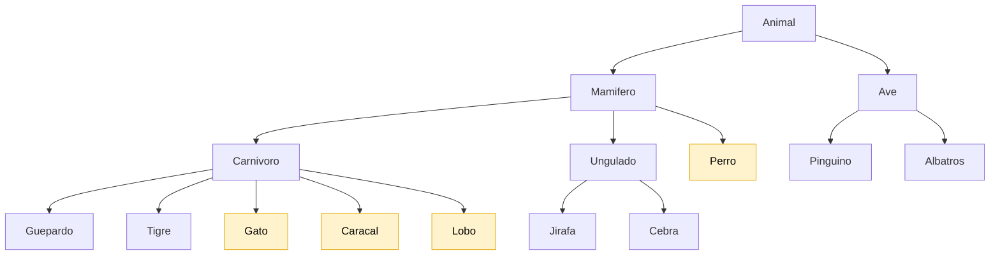
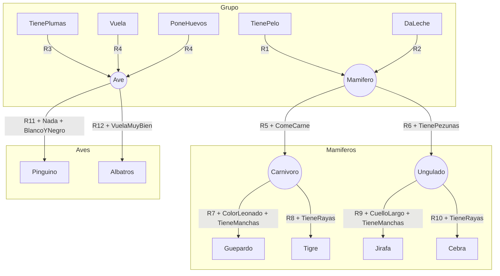
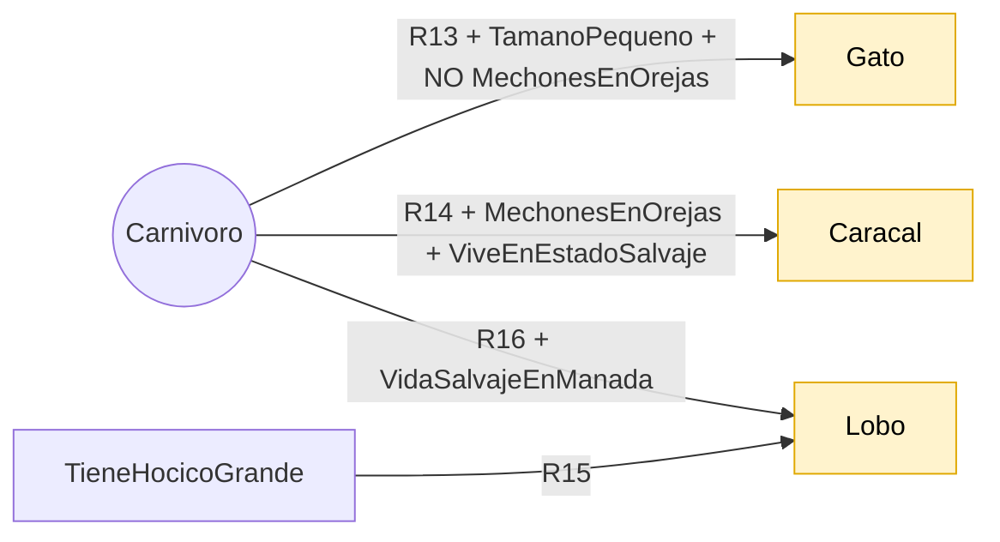
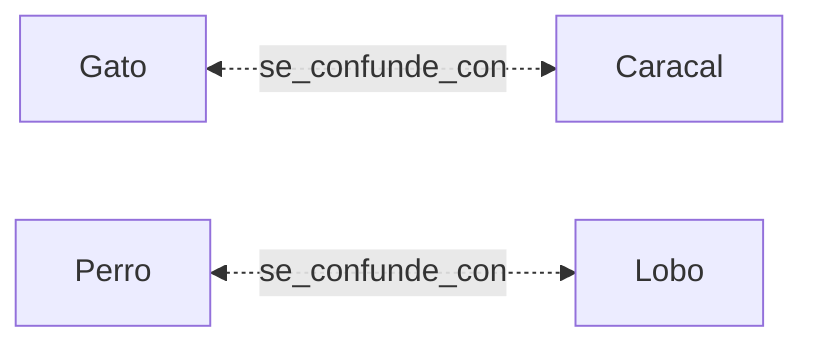
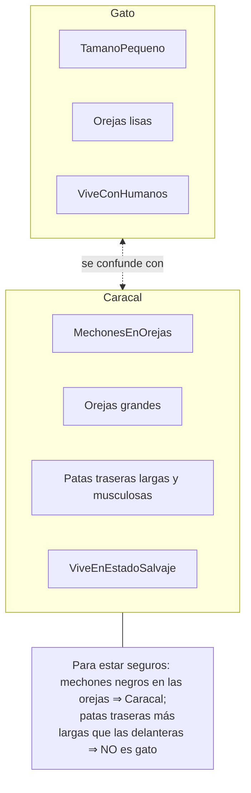
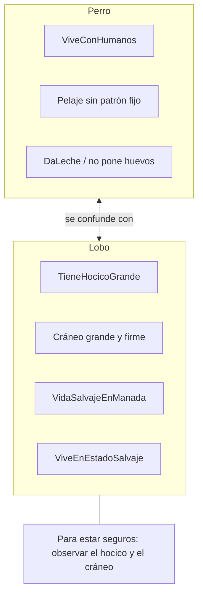
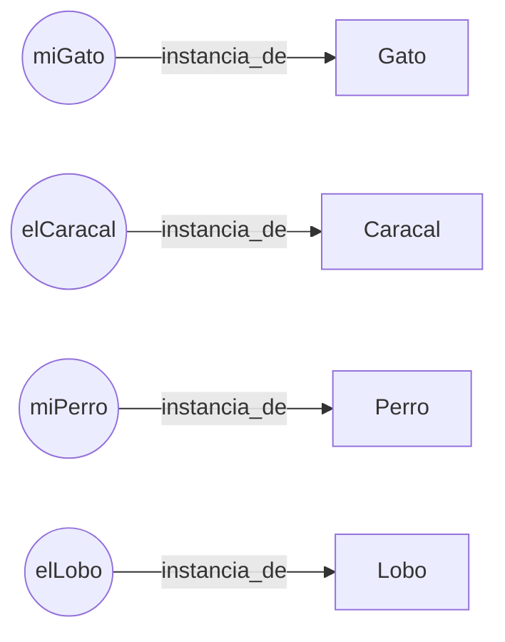

# Ontología: Identificación de animales

**Práctica:** Desarrollo de predicados
**Materia:** Programación Lógica y Funcional 
**Autores:** Guillermo Guzmán Mendoza (23760320)
**Docente:** María de Lourdes Aguillón Ruiz

Este documento grafica la información formalizada en predicados y transcrita en
[`base_conocimiento.py`](base_conocimiento.py). Los diagramas usan
[Mermaid](https://mermaid.js.org/), que GitHub renderiza automáticamente.

---

## Jerarquía de clases (relación `es_un`)

> Las clases en amarillo provienen de las **entrevistas**; el resto, de las
> **notas de la bióloga Ana Torres**.

---

## Reglas de clasificación (notas de la bióloga)

---

## Reglas nuevas de las entrevistas

---

## Vínculos entre especies confundibles

### Gato vs. Caracal (Entrevista 1)

### Perro vs. Lobo (Entrevista 2)

---

## Instancias y su inferencia

| Individuo | Hechos base | Cadena de inferencia | Conclusión |
|---|---|---|---|
| `miGato` | TienePelo, ComeCarne, TamanoPequeno, ViveConHumanos | R1 → R5 → R13 | Mamifero → Carnivoro → **Gato** |
| `elCaracal` | TienePelo, ComeCarne, TamanoPequeno, MechonesEnOrejas, ViveEnEstadoSalvaje | R1 → R5 → R14 | Mamifero → Carnivoro → **Caracal** |
| `miPerro` | TienePelo, DaLeche, ComeCarne, ViveConHumanos | R1 → R5 (+ declaración) | Mamifero → Carnivoro → **Perro** |
| `elLobo` | TienePelo, DaLeche, ComeCarne, TieneHocicoGrande, VidaSalvajeEnManada | R1 → R5 → R15 | Mamifero → Carnivoro → **Lobo** |

---

## Catálogo de predicados

### Predicados base (hechos observables)

| Predicado | Significado | Origen |
|---|---|---|
| `TienePelo(x)` | x tiene pelo | Notas |
| `DaLeche(x)` | x da leche a sus crías | Notas |
| `TienePlumas(x)` | x tiene plumas | Notas |
| `Vuela(x)` | x vuela | Notas |
| `PoneHuevos(x)` | x pone huevos | Notas |
| `ComeCarne(x)` | x come carne | Notas |
| `TienePezunas(x)` | x tiene pezuñas | Notas |
| `ColorLeonado(x)` | x es de color leonado | Notas |
| `TieneManchas(x)` | x tiene manchas oscuras | Notas |
| `TieneRayas(x)` | x tiene rayas negras | Notas |
| `CuelloLargo(x)` | x tiene el cuello largo | Notas |
| `Nada(x)` | x nada | Notas |
| `BlancoYNegro(x)` | x es de color blanco y negro | Notas |
| `VuelaMuyBien(x)` | x vuela muy bien | Notas |
| `TamanoPequeno(x)` | x es de tamaño pequeño | Entrevistas |
| `MechonesEnOrejas(x)` | x tiene mechones de pelo en las orejas | Entrevistas |
| `ViveConHumanos(x)` | x vive con humanos | Entrevistas |
| `ViveEnEstadoSalvaje(x)` | x vive en estado salvaje | Entrevistas |
| `TieneHocicoGrande(x)` | x tiene hocico grande | Entrevistas |
| `VidaSalvajeEnManada(x)` | x vive en manada en estado salvaje | Entrevistas |

### Predicados derivados (clases)

`Mamifero`, `Ave`, `Carnivoro`, `Ungulado`, `Guepardo`, `Tigre`, `Jirafa`,
`Cebra`, `Pinguino`, `Albatros`, `Gato`, `Caracal`, `Perro`, `Lobo`.

---

## Reglas (formalización en lógica de primer orden)

| # | Regla |
|---|---|
| 1 | ∀x (TienePelo(x) → Mamifero(x)) |
| 2 | ∀x (DaLeche(x) → Mamifero(x)) |
| 3 | ∀x (TienePlumas(x) → Ave(x)) |
| 4 | ∀x (Vuela(x) ∧ PoneHuevos(x) → Ave(x)) |
| 5 | ∀x (Mamifero(x) ∧ ComeCarne(x) → Carnivoro(x)) |
| 6 | ∀x (Mamifero(x) ∧ TienePezunas(x) → Ungulado(x)) |
| 7 | ∀x (Carnivoro(x) ∧ ColorLeonado(x) ∧ TieneManchas(x) → Guepardo(x)) |
| 8 | ∀x (Carnivoro(x) ∧ TieneRayas(x) → Tigre(x)) |
| 9 | ∀x (Ungulado(x) ∧ CuelloLargo(x) ∧ TieneManchas(x) → Jirafa(x)) |
| 10 | ∀x (Ungulado(x) ∧ TieneRayas(x) → Cebra(x)) |
| 11 | ∀x (Ave(x) ∧ Nada(x) ∧ BlancoYNegro(x) → Pinguino(x)) |
| 12 | ∀x (Ave(x) ∧ VuelaMuyBien(x) → Albatros(x)) |
| 13 | ∀x (Carnivoro(x) ∧ TamanoPequeno(x) ∧ ¬MechonesEnOrejas(x) → Gato(x)) |
| 14 | ∀x (Carnivoro(x) ∧ MechonesEnOrejas(x) ∧ ViveEnEstadoSalvaje(x) → Caracal(x)) |
| 15 | ∀x (TieneHocicoGrande(x) → Lobo(x)) |
| 16 | ∀x (Carnivoro(x) ∧ VidaSalvajeEnManada(x) → Lobo(x)) |

---

## Estructura en Python

| Estructura | Tipo | Contenido |
|---|---|---|
| `HECHOS` | `dict` → `set` | individuo → predicados verdaderos |
| `REGLAS` | lista de tuplas | `(id, [condiciones], conclusión)` |
| `VINCULOS` | lista de tuplas | `(sujeto, relación, objeto)` |
| `DISTINCION` | `dict` | rasgos para diferenciar especies confundibles |
| `inferir()` | función | encadenamiento hacia adelante |

**Ejecución:** `python base_conocimiento.py`

**Notas sobre supuestos:**
- La negación `¬MechonesEnOrejas` se implementa como *negación por fallo*: si el hecho no está registrado, se asume falso.
- `miPerro` se declara como `Perro` mediante `ESPECIES_DECLARADAS`, pues las entrevistas no incluyen una regla de clasificación para esa especie.
- En `miGato` y `elCaracal` se asumió `ComeCarne` y `TienePelo` por ser felinos mamíferos con pelaje.
